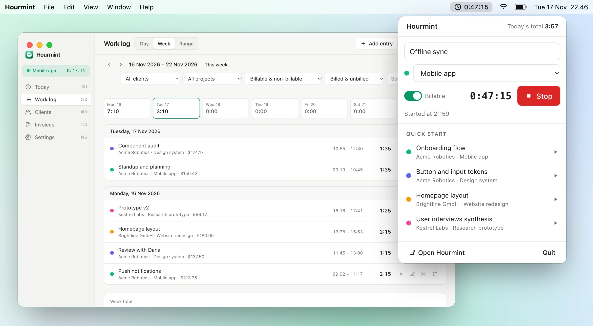

# Hourmint

Free, open source time tracker for Mac. Track client work from the menu bar, keep an honest work log, and turn selected hours into a PDF invoice with a detailed timesheet. Your data stays on your Mac.

**[Website](https://hourmint.abdur.tech)** | **[Download for Mac](https://github.com/abdurrahmanriyad/hourmint/releases/latest/download/Hourmint.dmg)** (macOS 13+, Apple Silicon and Intel)



## Develop

Requires Node 22 (`nvm use`), Rust stable and Xcode command line tools.

```sh
npm install
npm run app          # tauri dev: Vite + the native app with hot reload
npm run test:all     # typecheck + frontend tests + Rust tests
npm run demo         # the UI in a normal browser with fake data (src/demo/), for design checks and screenshots
npm run build:local  # Hourmint.app + .dmg for this Mac in src-tauri/target/release/bundle/
```

`npm run demo` opens `/demo.html`; add `?window=popover&frame=340x500`, `?window=idle&frame=440x260`, `&theme=dark`, `&onboarded=0` or `&clean=1` (hides the menu bar hint).

Data lives in `~/Library/Application Support/app.hourmint.desktop/` (`hourmint.sqlite`, `backups/`, `logos/`).

## Layout

| Path | What |
|---|---|
| `src-tauri/src/db.rs` | SQLite open, WAL, migrations (`PRAGMA user_version`), backup / restore, daily backups (keep 7) |
| `src-tauri/src/services/` | Business logic as plain functions over a `Connection` (unit-tested): settings, clients/projects, entries + timer, reports/CSV, invoices, export |
| `src-tauri/src/commands.rs` | Tauri commands; every mutation emits `data-changed` so all windows refetch |
| `src-tauri/src/tray.rs`, `windows.rs` | Menu bar icon with elapsed time, popover window, idle prompt window |
| `src-tauri/src/idle.rs` | Background monitor: idle detection, long-timer warning, start reminder, daily backup |
| `src-tauri/src/shortcut.rs` | Global start/stop shortcut |
| `src/strings.ts` | All UI text (translation-ready) |
| `src/lib/` | Typed API, formatting (currency minor units, durations, dates), React Query hooks, PDF templates |
| `src/pages/`, `src/windows/` | Screens; the same bundle renders the main window, popover or idle prompt depending on the window label |
| `src/lib/updates.ts` | In-app updates (Tauri updater) from GitHub Releases |
| `site/` | Landing page and privacy policy (static HTML), published to <https://hourmint.abdur.tech> by `.github/workflows/pages.yml` |

Conventions: UUID text ids, `created_at/updated_at/deleted_at` on every table with soft deletes, UTC ISO 8601 timestamps, money as integer minor units, durations in seconds. The running timer is the single entry with `ended_at IS NULL` (enforced by a unique partial index), so it survives quit, crash and sleep.

### Decisions worth knowing

- **PDF**: generated on device with `@react-pdf/renderer` (paginated, selectable text, embedded Noto Sans so symbols like ₹ ₺ ₦ render). The builder shows an HTML live preview that mirrors the PDF layout. Font licence: `src/assets/fonts/OFL.txt`.
- **Rates are snapshotted** onto each entry (`time_entries.invoice_rate`) when it is added to an invoice, and onto `invoice_lines`, so later rate changes never alter existing invoices.
- **Locking**: an entry is locked as soon as it is on any invoice (including a draft). Unchecking it in a draft or deleting the invoice releases it. "Billed" in filters means "on an invoice".
- **Rounding "none"** rounds each line to the nearest minute so hours × rate always matches the amount shown.
- **Global shortcut** is off by default; set one in Settings → Timer.
- **Extra columns** beyond the spec: `settings.number_locale`, `reminder_*`, `timesheet_show_source`, `onboarded`; `invoices.period_start/period_end`, `discount_amount`; `time_entries.invoice_rate`.

## Builds

There are two builds of the same code:

| | Direct download | Mac App Store |
|---|---|---|
| Cargo features | `direct` (default) | `--no-default-features` |
| Sandbox | No | Yes (`src-tauri/appstore/entitlements.plist`) |
| Updates | In-app, from GitHub Releases | By the App Store |
| Data folder | `~/Library/Application Support/app.hourmint.desktop/` | `~/Library/Containers/app.hourmint.desktop/` |
| Build | `npm run build:local` / release workflow | `npm run build:appstore` (see [docs/APP_STORE.md](docs/APP_STORE.md)) |

Launch at login uses SMAppService in both builds. Logs are written to `~/Library/Logs/app.hourmint.desktop/` (inside the container for the App Store build).

## Release (direct download, macOS)

Releases are built by GitHub Actions (`.github/workflows/release.yml`) as a universal app (Apple Silicon + Intel) and published to [GitHub Releases](https://github.com/abdurrahmanriyad/hourmint/releases). The app checks `releases/latest/download/latest.json` on launch and every 12 hours, and Settings has a "Check for updates" button.

One-time setup:

1. Add repository secrets (Settings → Secrets and variables → Actions):
   - `TAURI_SIGNING_PRIVATE_KEY`: the contents of `~/.tauri/hourmint.key` (the updater signing key; its public half is in `tauri.conf.json`). **Back this file up.** If it's lost, installed copies can't verify future updates.
     `gh secret set TAURI_SIGNING_PRIVATE_KEY --repo abdurrahmanriyad/hourmint --body "$(cat ~/.tauri/hourmint.key)"`
   - `TAURI_SIGNING_PRIVATE_KEY_PASSWORD` is only needed if you regenerate the key with a password. A missing secret counts as empty.
2. The repository must be public for the updater and download links to work without a token.
3. To publish the landing page, enable GitHub Pages with source "GitHub Actions" and custom domain `hourmint.abdur.tech` (DNS: CNAME `hourmint` → `abdurrahmanriyad.github.io`).

To cut a release:

```sh
npm version patch          # bumps package.json (the app version) and creates tag vX.Y.Z
git push --follow-tags     # CI builds, tests and drafts the release
```

Then open the draft on GitHub and publish it. Installed apps see the update once it's published.

Until there is an Apple Developer ID, builds are ad-hoc signed (`signingIdentity: "-"`). macOS asks users to confirm the first launch: System Settings → Privacy & Security → Open Anyway. To sign and notarize later, add the `APPLE_*` secrets and uncomment them in the release workflow.

## Licence

[MIT](LICENSE). The bundled Noto Sans fonts are under the SIL Open Font License (`src/assets/fonts/OFL.txt`).
